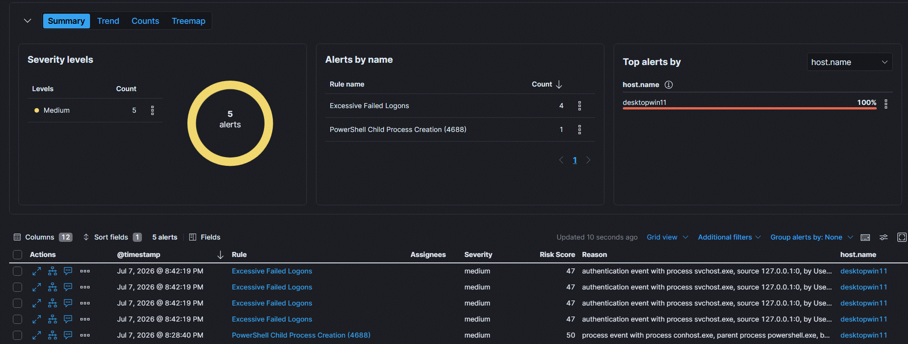

# Active Directory Security & Detection Engineering Lab

### THE.WIRED | Windows Security | Elastic SIEM | Adversary Simulation | AI-Assisted Detection Engineering

A hands-on cybersecurity homelab exploring Windows authentication security, credential-access techniques, lateral movement, endpoint telemetry, and detection engineering.

This project combines controlled adversary simulation with defensive investigation to understand how attacks operate, which security controls affect them, and what evidence defenders can use to identify suspicious activity.

The lab has evolved from Windows endpoint security research into a broader Active Directory detection environment, incorporating Domain Controller telemetry and AI-assisted security engineering using Codex.

---

## 1. Executive Summary

This repository documents a virtualized Windows security laboratory built using VMware Workstation, Windows Server, Windows 11 Enterprise, Ubuntu Linux, Sysmon, and Elastic Security.

The original research focused on simulating credential access and Pass-the-Hash (PtH) lateral movement inside an authorized lab environment.

Testing included:

- Investigating Windows 11 LSASS access restrictions.
- Creating and analyzing an offline LSASS memory dump.
- Using Pypykatz to inspect authentication material.
- Simulating Pass-the-Hash authentication with Impacket.
- Investigating Windows remote administration restrictions.
- Observing process creation, authentication, and service-installation telemetry.
- Developing detection logic for suspicious Windows activity.

In November 2026, I extended the project using Codex to assist with infrastructure diagnostics, telemetry collection, and detection engineering.

This work identified a Domain Controller logging gap, established centralized collection through Elastic Agent, and resulted in a successfully validated Kerberos authentication failure detection.

**Primary objective:** Develop practical security engineering skills by connecting adversary behavior, Windows event telemetry, detection logic, and verified security alerts.

---

## 2. Lab Architecture & Topology

The environment consists of three primary virtual machines hosted in VMware Workstation.

| System | Role | Primary Technologies |
|---|---|---|
| Windows Server | Domain Controller | Active Directory, DNS, Kerberos, Windows Security Auditing |
| Windows 11 Enterprise | Domain-joined workstation | Sysmon, Windows Event Logs, PowerShell, Elastic Agent |
| Ubuntu Linux | SIEM infrastructure | Elasticsearch, Kibana, Fleet, Elastic Agent |
| Windows host | Virtualization and administration | VMware Workstation, PowerShell, Codex |

### Network Architecture

The VMware environment uses a host-only lab network for internal communication.

Additional NAT and guest network adapters were also identified during infrastructure discovery.

Complete isolation from external networks was not independently established; improving network segmentation remains a future hardening objective.

### Telemetry Pipeline

```text
Windows Server Domain Controller
    |
    | Security / System / PowerShell Events
    |
    v
Elastic Agent
    |
    v
Elasticsearch
    |
    v
Kibana / Elastic Security
    |
    v
Detection Rules & Alerts


Windows 11 Workstation
    |
    | Security / Sysmon / PowerShell Events
    |
    v
Elastic Agent
    |
    v
Elasticsearch
```

Both the Domain Controller and Windows 11 workstation contribute telemetry to the centralized Elastic environment.

---

## 3. Detection Engineering Outcomes

### Detection 1 — Excessive Failed Authentication Attempts (Event ID 4625)



**Objective:** Identify repeated failed Windows authentication attempts.

**Detection Query:**

```kql
event.code:4625
```

The lab previously documented a threshold of three failed logons within five minutes.

During the November 2026 review, however, the live rule was found to use a basic Event ID 4625 query rather than the documented threshold configuration.

This discrepancy is retained as an example of why detection documentation must be compared with actual deployed rule settings.

**Validation:** Controlled failed-login activity generated security telemetry and Elastic alerts.

**Improvement needed:** Reconcile the deployed 4625 rule with the intended threshold logic and document its exact exported configuration.

**MITRE ATT&CK:** T1110 — Brute Force

---

### Detection 2 — AI-Assisted Kerberos Authentication Failures (Event ID 4771)

**Status: Successfully validated**

**Objective:** Detect repeated Kerberos preauthentication failures involving an incorrect password against the same account from the same source.

In November 2026, Codex assisted with inspecting the existing Active Directory and Elastic environment.

The investigation identified that the Domain Controller was not forwarding Windows security events into Elasticsearch.

Before creating the new detection, the telemetry gap needed to be addressed.

#### Domain Controller Telemetry Integration

The following work was completed:

1. Created a dedicated Elastic Fleet policy for the Domain Controller.
2. Configured Windows Security, System, Application, and PowerShell event collection.
3. Enabled Kerberos and NTLM authentication failure auditing.
4. Enabled process creation auditing with command-line logging.
5. Preserved configuration backups.
6. Installed and enrolled Elastic Agent.
7. Confirmed successful security-event ingestion.

A verification query showed recent Domain Controller events including:

| Event ID | Count | Description |
|---|---:|---|
| 4624 | 73 | Successful logons |
| 4688 | 42 | Process creation |
| 4776 | 30 | NTLM credential validation |

These counts represent one observed 15-minute validation period, not an ongoing baseline.

#### Detection Configuration

The new Elastic detection was configured as follows:

| Parameter | Value |
|---|---|
| Event ID | 4771 |
| Kerberos failure code | `0x18` |
| Failure type | Incorrect password |
| Threshold | 3 events |
| Time window | 5 minutes |
| Grouping | Account and source IP |
| Execution interval | 1 minute |
| Severity | Medium |
| Risk score | 47 |

**Conceptual KQL:**

```kql
event.code: "4771" and winlog.event_data.Status: "0x18"
```

This query illustrates the intended event filtering. The exact deployed rule definition and threshold configuration have not yet been exported into the repository.

#### Controlled Validation

Codex assisted with generating three controlled Kerberos authentication failures from the Windows 11 workstation using a designated test account.

The Domain Controller recorded the expected 4771 events with failure status `0x18`.

The test account remained unlocked.

Elastic Security subsequently generated the corresponding Medium-severity alert.

**Result: The detection successfully triggered during controlled testing.**

#### Why This Matters

Kerberos preauthentication failures can indicate:

- Password guessing or brute-force attempts.
- Incorrectly configured services.
- Stale stored credentials.
- Legitimate password mistakes.
- Potential account compromise attempts.

The detection is an investigation signal, not proof of malicious activity.

Future work will correlate repeated failures with successful authentication and subsequent endpoint activity.

**MITRE ATT&CK:** T1110 — Brute Force

**[Read the full AI-Assisted Kerberos 4771 Detection Case Study](detections/kerberos-4771-ai-assisted.md)**

---

## 4. Adversarial Phase 1 — Local Credential Access

**MITRE ATT&CK: T1003.001 — OS Credential Dumping: LSASS Memory**

### Objective

Investigate Windows credential-access protections and understand the telemetry associated with credential extraction techniques.

### Baseline Security Controls

The Windows 11 environment presented several obstacles during testing.

**LSA Protection (PPL):** Attempts to access LSASS memory directly were denied, producing `0x00000005 (Access Denied)`.

**Memory Parsing Compatibility:** Some legacy tooling encountered errors when interpreting Windows authentication structures, requiring a different analysis approach.

These observations informed the subsequent offline credential analysis.

### Offline Credential Analysis

The exercise used a controlled sequence within the lab:

1. Established a local administrative execution context.
2. Generated an LSASS process minidump through Windows Task Manager.
3. Transferred the lab-generated dump to the isolated Ubuntu analysis system using WinSCP.
4. Analyzed the offline dump with Pypykatz.

**Analysis command:**

```bash
pypykatz lsa minidump /home/[user]/lsass.DMP
```

### Result

Pypykatz successfully extracted an NT authentication hash from the lab-generated memory dump.

This demonstrated the security implications of access to sensitive authentication-process memory.

The testing did not establish a general bypass of all Windows credential protections or all endpoint security products.

**Key lesson:** Administrative access to sensitive process memory can expose reusable authentication material, making credential protection and endpoint monitoring important defensive controls.

---

## 5. Adversarial Phase 2 — Lateral Movement via Pass-the-Hash

**MITRE ATT&CK: T1550.002 — Use Alternate Authentication Material: Pass the Hash**

### Objective

Demonstrate how an attacker possessing an NT authentication hash may authenticate to a remote Windows system without knowing the plaintext password.

### Remote Administration Restrictions

Initial attempts encountered restrictions involving:

- Remote UAC token filtering.
- Administrative share access.
- Windows Defender Firewall.
- Remote service execution.
- Endpoint protection behavior.

The laboratory configuration was adjusted to reproduce conditions where remote administrative execution could occur.

### Simulation

The experiment used Impacket's `psexec.py` implementation against an authorized Windows test system.

Example with sanitized credentials:

```bash
psexec.py ./Administrator@10.x.x.x -hashes 00000000000000000000000000000000:[SANITIZED_NT_HASH]
```

The original experiment demonstrated authentication using NT hash material rather than a plaintext password.

### Verification

Remote execution was established, and the resulting shell reported:

```cmd
C:\Windows\System32> whoami
nt authority\system
```

This demonstrated SYSTEM-level execution on the lab target through the tested remote service execution method.

It did not establish Domain Administrator privileges or compromise outside the isolated test environment.


### Key Lesson

Successful remote execution requires more than valid authentication material.

Network reachability, administrative permissions, Windows security policy, and endpoint protections all affect whether the technique succeeds.

---

## 6. Engineering Log — Defensive Controls & Troubleshooting

One of the primary goals of this laboratory is to investigate technical obstacles rather than treating every failed command as an unsuccessful experiment.

| Diagnostic Symptom | Observed or Suspected Cause | Troubleshooting Approach |
|---|---|---|
| LSASS access denied | Windows LSA protection restricted memory access | Shifted to controlled offline analysis |
| Authentication structure parsing failures | Compatibility issues with the memory analysis tooling | Used Pypykatz for offline parsing |
| Administrative share inaccessible | Remote UAC and account-token restrictions | Investigated administrative context and local account policies |
| SMB connection timeout | Windows Firewall restricting inbound connectivity | Inspected and adjusted authorized lab firewall rules |
| Remote service execution stalls | Possible endpoint protection interference | Investigated relevant security controls and test conditions |
| DC security events missing in Elastic | Domain Controller lacked Elastic Agent collection | Created dedicated Fleet policy and enrolled agent |
| Existing 4625 rule configuration differed from README | Deployed rule did not match documented threshold behavior | Identified discrepancy for correction and validation |

This engineering log records the progression from adversarial testing to defensive visibility and monitoring improvements.

---

## 7. Detection Engineering & SIEM Hunting

The adversarial simulations provide several opportunities for defensive detection engineering.

### Detection Opportunity A — LSASS Process Access

**MITRE ATT&CK:** T1003.001

**Telemetry:** Sysmon Event ID 10

Potential indicators include:

- Unexpected processes requesting access to `lsass.exe`.
- Suspicious process-access rights.
- Unusual calling processes or associated call traces.
- Process-access patterns inconsistent with established administrative baselines.

Possible access masks of interest include `0x1F1833` and `0x1010`.

These values require contextual interpretation. A specific access mask alone is not sufficient proof of malicious behavior.

### Detection Opportunity B — NTLM Network Authentication

**Telemetry:** Windows Security Event ID 4624

Potential indicators include:

- Logon Type 3 — Network logon.
- Authentication package NTLM.
- Unexpected administrative source systems.
- Unusual account and destination combinations.
- Authentication characteristics inconsistent with the expected environment.

An NTLM network logon does not independently prove Pass-the-Hash activity.

Additional process, service, account, and network evidence is required to investigate that possibility.

### Detection Opportunity C — Suspicious Service Installation

**MITRE ATT&CK:** T1543.003 — Windows Service

**Telemetry:**

- Windows System Event ID 7045 — New service installation.
- Sysmon Event ID 1 — Process creation.

Potential indicators include:

- Newly installed services using unexpected executable paths.
- Short-lived services associated with remote administration.
- Unusual service binary names.
- Process execution and service-installation events occurring close together.
- Administrative network logons followed by remote execution.

Event ID 7045 is recorded in the Windows **System** log, not the Security log.

### Detection Opportunity D — Authentication Failure Correlation

**Telemetry:**

- Event ID 4771 — Kerberos preauthentication failure.
- Event ID 4768 — Kerberos authentication ticket request.
- Event ID 4624 — Successful Windows logon.
- Event ID 4688 — Process creation.

A future investigation scenario will correlate repeated failed authentication attempts with successful authentication and subsequent activity.

A successful Kerberos ticket request alone does not prove that a destination logon occurred.

The goal is to connect identity, source, destination, and process evidence into a defensible incident timeline.

---

## 8. AI-Assisted Security Engineering with Codex

In November 2026, I introduced Codex into the existing THE.WIRED environment to help automate diagnostics and accelerate detection engineering.

The workflow used authorized access to the VMware-hosted Linux and Windows systems.

### Infrastructure Discovery

Codex assisted with identifying:

- VMware Workstation installation and available management tools.
- Existing VM configuration files.
- Running VM states.
- Virtual network assignments.
- Available snapshot information.
- Relevant connectivity issues.

### Remote Administration

The lab used:

- Dedicated SSH key authentication for Ubuntu.
- PowerShell Remoting for Windows systems.
- Locally entered Windows credentials.
- Windows-protected credential storage.
- Scoped Windows firewall rules.
- Existing Kibana and Elastic management interfaces.

Passwords and enrollment secrets were not intended to be stored in chat messages or committed to source control.

### Telemetry and Detection Automation

Codex assisted with:

1. Validating Elastic service health.
2. Verifying Windows event ingestion.
3. Identifying missing Domain Controller collection.
4. Establishing a dedicated DC Fleet configuration.
5. Verifying authentication-related events.
6. Creating an Elastic detection rule.
7. Performing controlled validation.
8. Confirming the resulting security alert.

### Human Oversight

Significant infrastructure modifications were subject to explicit approval during the documented workflow.

The process also revealed opportunities to improve the security architecture.

The initial Windows remoting implementation used a privileged domain account and should not be interpreted as a production-ready least-privilege automation design.

Future improvements include restricted automation identities, finer-grained permissions, stronger execution boundaries, and auditable rule deployment.

**Related case study:** [AI-Assisted Kerberos 4771 Detection Engineering](detections/kerberos-4771-ai-assisted.md)

---

## 9. Relationship to the Elastic SIEM Lab

This repository focuses on Windows security investigations and detection engineering.

The related [Elastic SIEM Lab](https://github.com/Roman-Layer01/siem-lab) documents the underlying monitoring infrastructure, event ingestion pipeline, and additional detection rules.

Both projects use the existing THE.WIRED virtual environment.

| Repository | Primary Focus |
|---|---|
| Active Directory Detection Lab | Authentication security, adversary simulation, and detection validation |
| Elastic SIEM Lab | Elasticsearch, Kibana, Fleet, endpoint logging, and SIEM operations |

Together, they demonstrate the connection between infrastructure administration, adversary behavior, security telemetry, and detection development.

---

## 10. Key Lessons Learned

### Security Controls Affect Adversary Behavior

Windows authentication and endpoint protection features introduced obstacles that influenced the simulation.

Understanding why a technique fails can be as informative as observing it succeed.

### Authentication Events Require Context

A failed logon, NTLM authentication event, or Kerberos ticket request should not be interpreted in isolation.

Account identity, source system, destination, privileges, and related process activity all contribute to an investigation.

### Telemetry Availability Comes Before Detection Logic

The Domain Controller collection gap demonstrated that a detection cannot generate the expected alert if relevant events are not being ingested.

### Detection Rules Must Be Validated

Creating an Elastic rule is not the same as proving that it detects the intended activity.

The Kerberos 4771 investigation included controlled event generation and verification of an actual security alert.

### AI Can Accelerate Engineering but Requires Verification

Codex helped inspect infrastructure, configure collection, and develop detection logic.

However, authorization boundaries, accurate troubleshooting, credential handling, and validation remained essential.

### Transparent Documentation Improves Credibility

This repository distinguishes confirmed outcomes from hypotheses, planned improvements, and configuration details that have not yet been exported or independently verified.

---

## 11. Current Project Status

| Capability | Status |
|---|---|
| VMware lab deployment | Operational during latest assessment |
| Windows 11 security telemetry | Validated |
| Sysmon logging | Validated |
| Elastic SIEM ingestion | Validated |
| Domain Controller event collection | Validated |
| Kerberos 4771 detection | Validated |
| Controlled authentication alert | Successfully triggered |
| Offline credential analysis | Completed in lab |
| Pass-the-Hash simulation | Completed in lab |
| LSASS process-access detection rule | Research / hunting logic |
| Failed-authentication-followed-by-success correlation | Planned |
| Least-privilege AI automation access | Planned |

---

## 12. Future Development

Planned work includes:

- Export and sanitize the deployed Kerberos 4771 detection rule.
- Correct and retest the existing Event ID 4625 rule.
- Develop authentication failure-to-success correlation.
- Correlate Domain Controller authentication with workstation activity.
- Validate additional Sysmon process-access detections.
- Develop reusable PowerShell scripts for Windows telemetry checks.
- Improve lab network isolation.
- Implement least-privilege AI automation identities.
- Document sanitized validation evidence and false-positive testing.
- Expand identity-focused detection engineering.

---

## 13. Project Scope and Safety

All adversarial simulations are intended for personally controlled or explicitly authorized laboratory systems.

The repository documents testing methodology and defensive security observations. It is not a record of activity against third-party systems.

Sensitive authentication material, real credentials, private keys, enrollment secrets, and unsanitized credential dumps must not be committed to the repository.

Some simulations involved weakening or changing security settings to demonstrate specific behaviors. These configurations are not recommended as production security baselines.

---

## Conclusion

THE.WIRED has evolved into a multi-layer Windows security and detection engineering environment.

The project began with credential-access and lateral-movement simulations and expanded into centralized Active Directory authentication monitoring, Elastic SIEM integration, and AI-assisted detection engineering.

The validated Kerberos 4771 detection demonstrates the complete workflow from identifying a logging gap to configuring collection, generating controlled activity, and confirming an Elastic Security alert.

The overall goal is to build practical security engineering expertise through investigation, reproducible experimentation, and evidence-backed detection development.

---

**Project:** THE.WIRED Cybersecurity Homelab  
**Focus:** Active Directory Security, Detection Engineering, and AI-Assisted Security Operations  
**Status:** Active Development
